# Swag Labs: walkthrough

15 screens in 5 flows, captured from https://www.saucedemo.com on 2026-10-30 12:31 IST.

Captured read-only: the guard blocked 10 request(s) (listed at the end).

## Contents

1. [Signing in](#signing-in) (2)
2. [Products](#products) (3)
3. [Checking out](#checking-out) (6)
4. [The menu](#the-menu) (1)
5. [The same checkout, as error_user](#the-same-checkout-as-erroruser) (3)

## Signing in

### 1. The sign-in page lists the test accounts and their shared password.

`/` · after: go to /

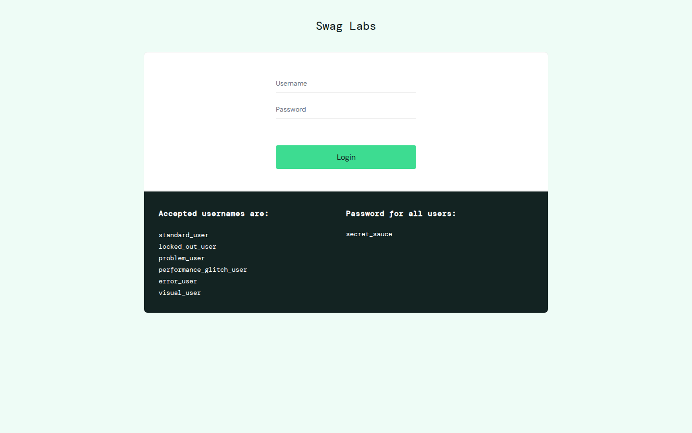

### 2. A locked-out account is turned away with a message.

`/` · after: click [data-test=login-button]

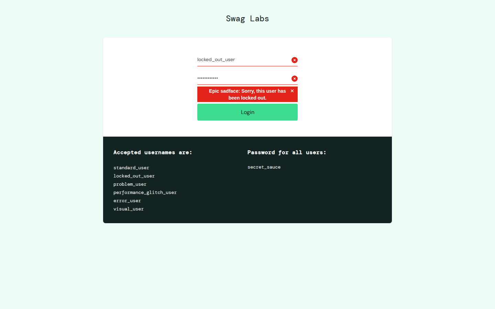

## Products

### 1. Every product on one page, A to Z.

`/inventory.html` · after: go to /inventory.html

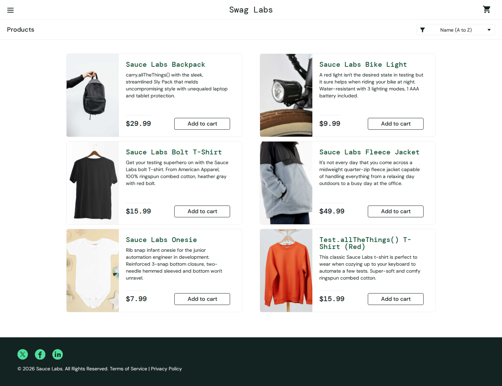

### 2. Sorted by price, cheapest first.

`/inventory.html`

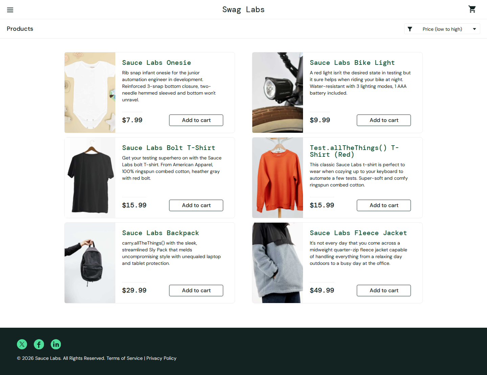

### 3. One product: description, price and Add to cart.

`/inventory-item.html?id=2` · after: open the first row

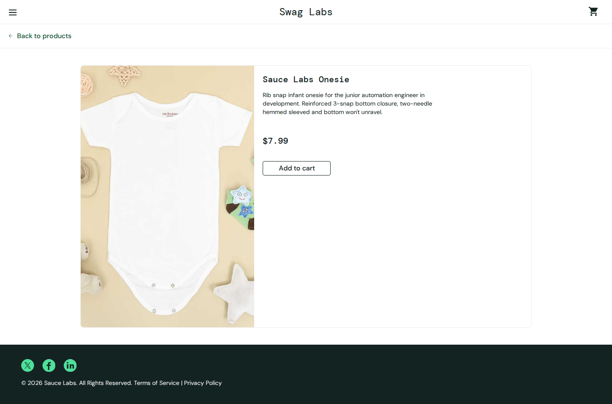

## Checking out

### 1. Two items added: the cart icon counts them.

`/inventory.html` · after: click [data-test=add-to-cart-sauce-labs-bike-light]

### 2. The cart.

`/cart.html` · after: click [data-test=shopping-cart-link]

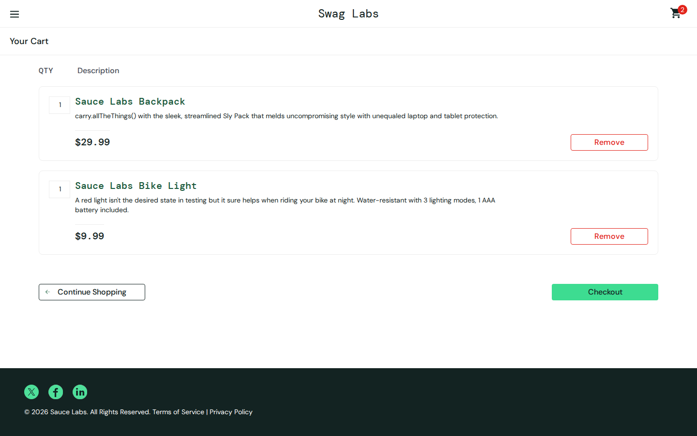

### 3. Continue with nothing filled in: the form says what is missing.

`/checkout-step-one.html` · after: click [data-test=continue]

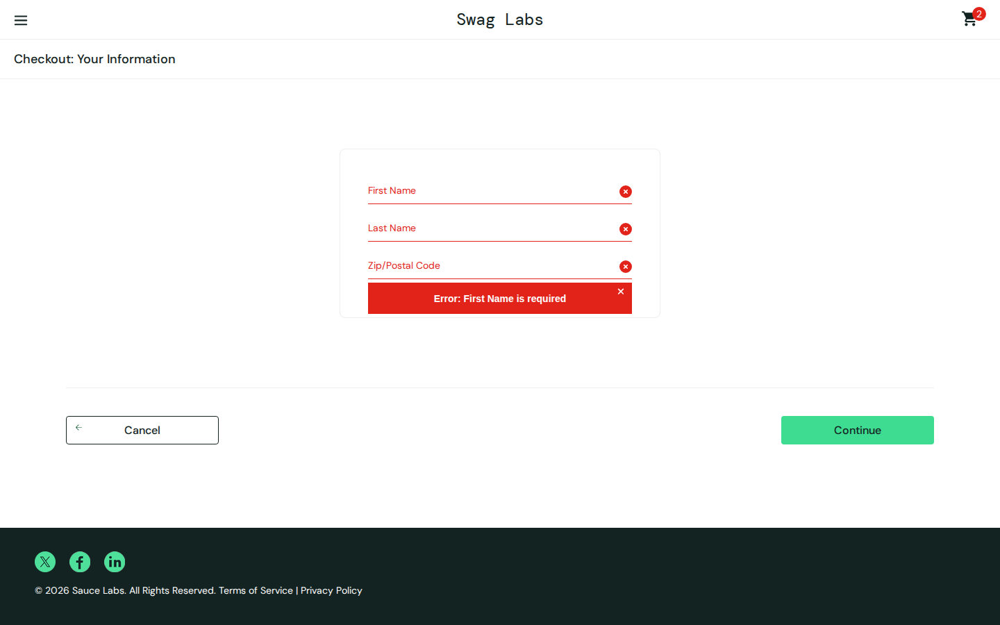

### 4. Name and postcode filled in.

`/checkout-step-one.html`

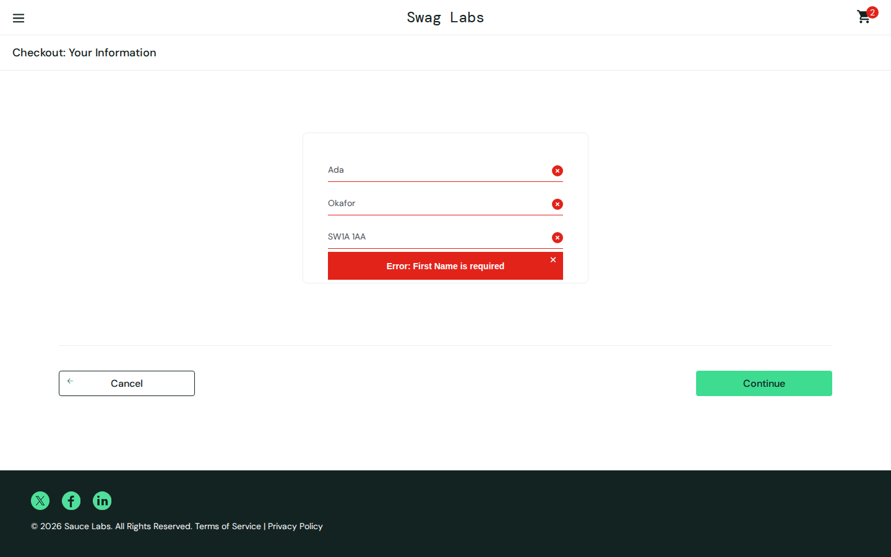

### 5. The overview: items, payment, delivery and the total with tax.

`/checkout-step-two.html` · after: click [data-test=continue]

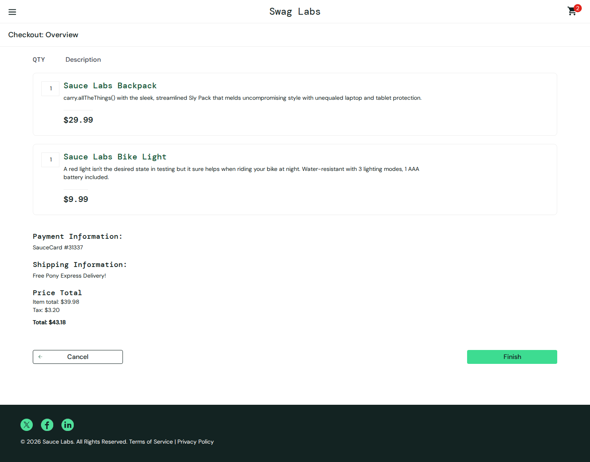

### 6. Order placed. A practice shop: nothing is sent or charged.

`/checkout-complete.html` · after: click [data-test=finish]

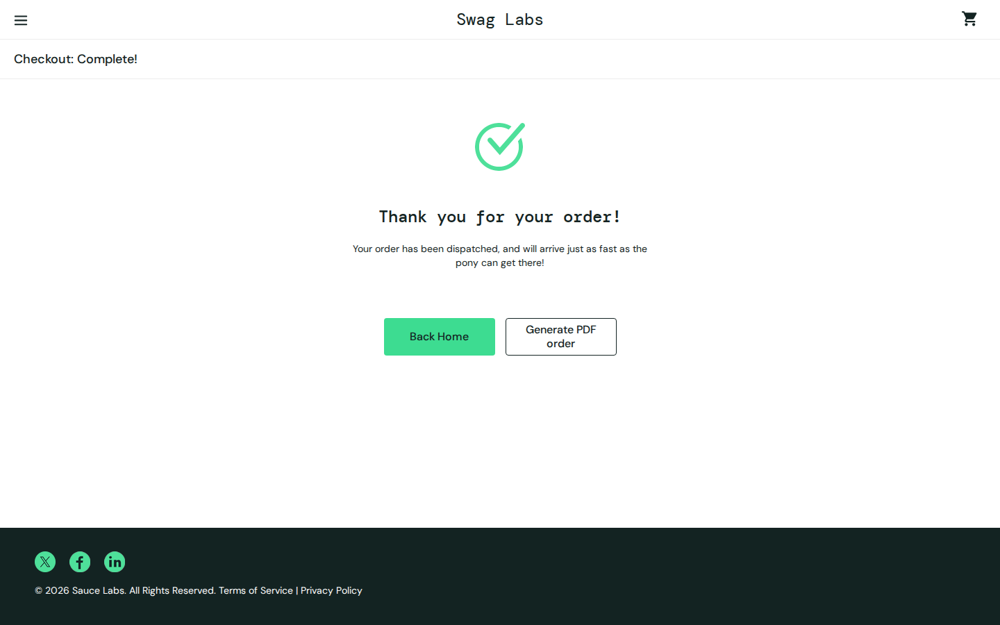

## The menu

### 1. The side menu.

`/inventory.html` · after: click #react-burger-menu-btn

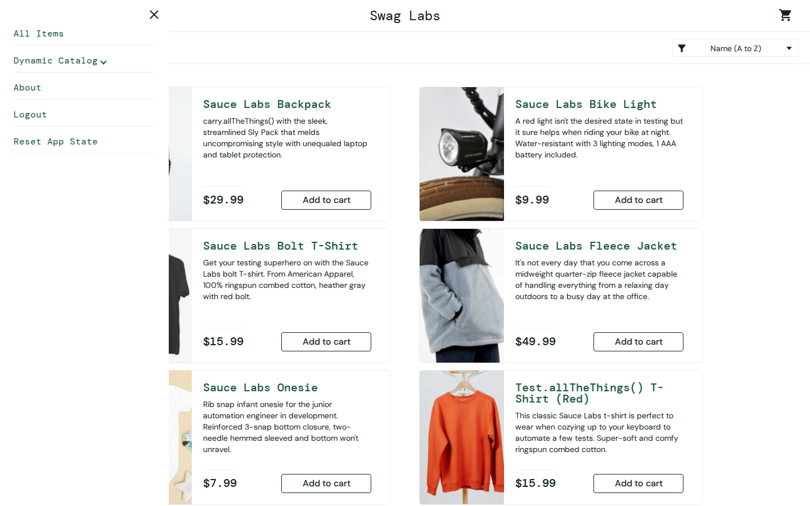

## The same checkout, as error_user

error_user is one of the site's test accounts, with bugs planted in it. Most screens look normal; the page errors behind them are listed under "What looked broken" at the end.

### 1. Add to cart worked for the backpack but not the T-shirt: the cart counts one.

`/inventory.html` · after: click [data-test=add-to-cart-sauce-labs-bolt-t-shirt]

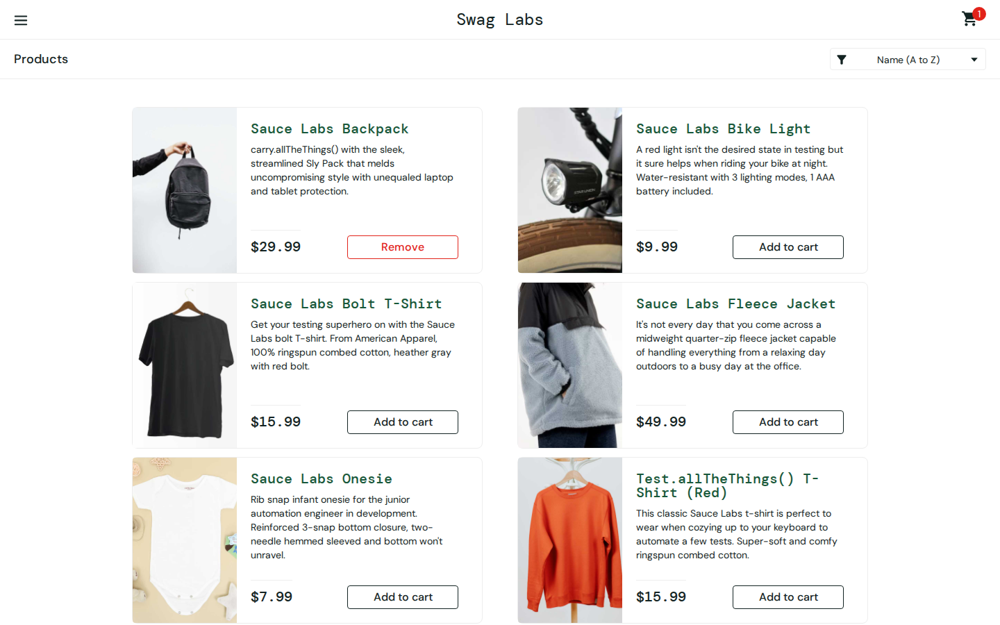

### 2. The last name was typed but stays empty.

`/checkout-step-one.html` · after: click [data-test=checkout]

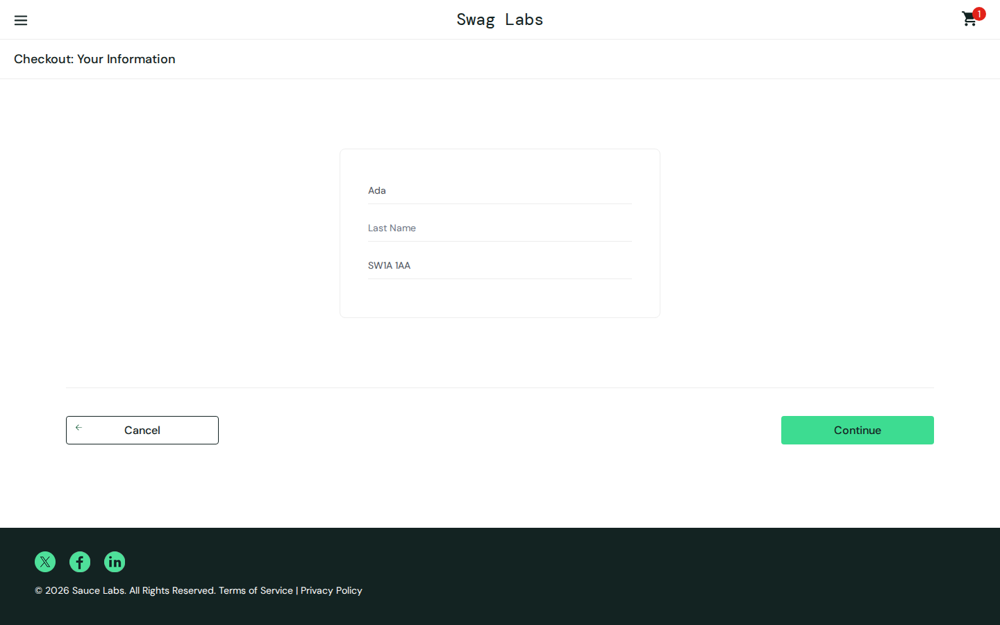

### 3. Finish does nothing: still on the overview.

`/checkout-step-two.html` · after: click [data-test=finish]

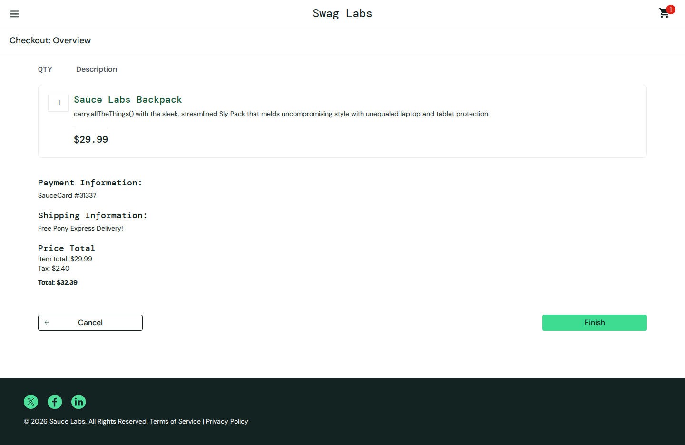

## What looked broken

- **The same checkout, as error_user › Add fails**: page error: Failed to add item to the cart.
- **The same checkout, as error_user › Last name empty**: page error: Cannot read properties of undefined (reading 'value')
- **The same checkout, as error_user › Finish stuck**: page error: wa.cesetRart is not a function

## Blocked by the read-only guard

- `POST https://events.backtrace.io/api/unique-events/submit?universe=UNIVERSE&token=TOKEN` (×3)
- `POST https://events.backtrace.io/api/summed-events/submit?universe=UNIVERSE&token=TOKEN` (×3)
- `POST https://submit.backtrace.io/UNIVERSE/TOKEN/json` (×4)
